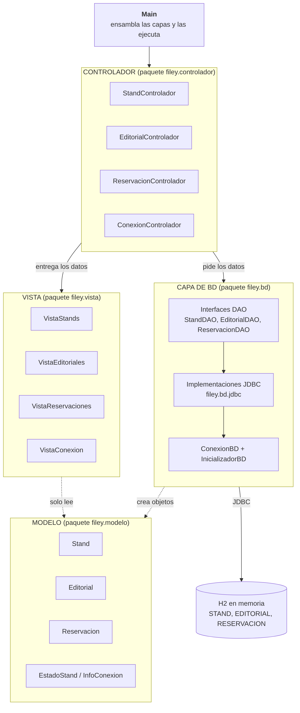
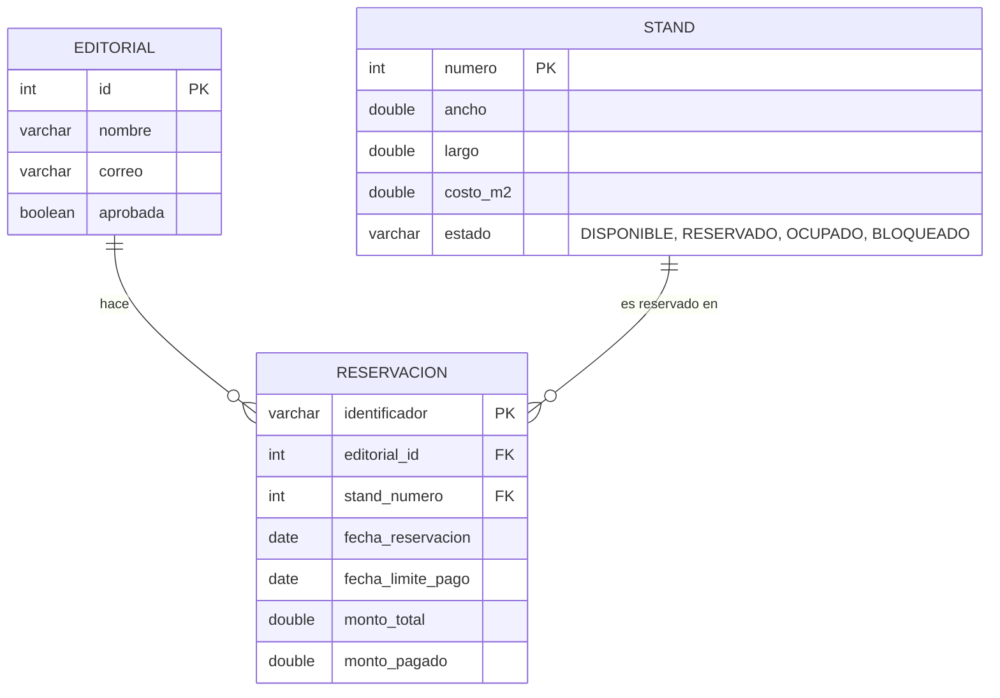
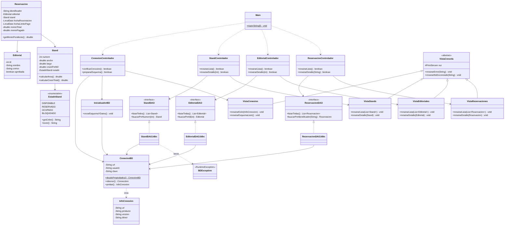
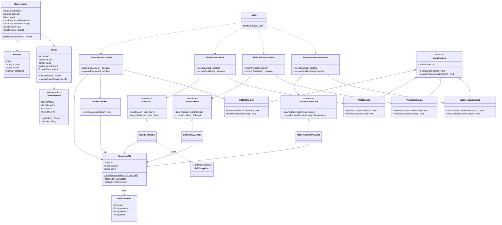
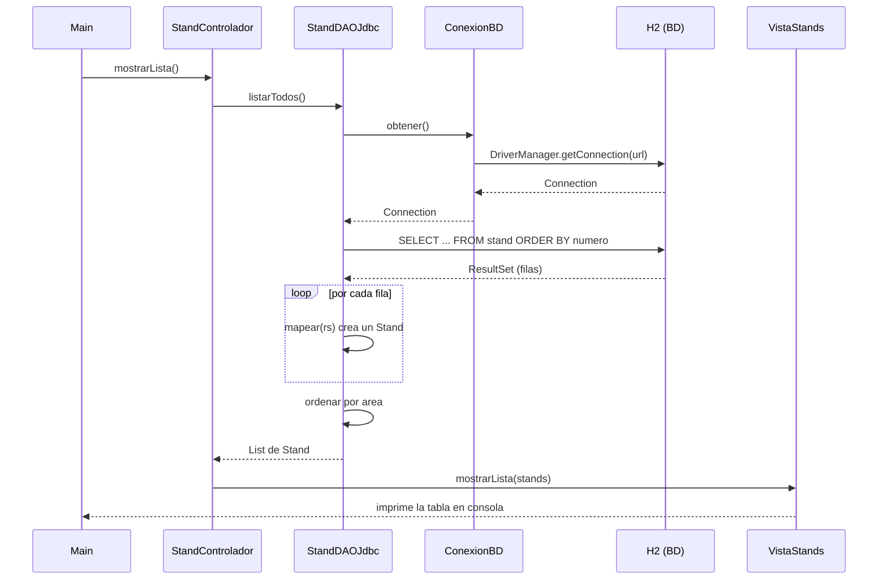

# FILEY – MVC + capa de base de datos (JDBC)

Lectura de las tablas **STAND**, **EDITORIAL** y **RESERVACION** desde una base de datos H2 en memoria, usando el patrón **MVC** más una **capa de BD** separada (DAO + JDBC).

## Índice

1. [Estructura del repositorio](#1-estructura-del-repositorio)
2. [Arquitectura por capas](#2-arquitectura-por-capas)
3. [Diagrama de Entidad-Relación](#3-diagrama-de-entidad-relación)
4. [Diagrama de clases](#4-diagrama-de-clases)
5. [Detalle de cada capa](#5-detalle-de-cada-capa)
6. [Cómo funciona una lectura (secuencia)](#6-cómo-funciona-una-lectura-secuencia)
7. [JDBC: lo que hace el código](#7-jdbc-lo-que-hace-el-código)
8. [Datos de ejemplo](#8-datos-de-ejemplo)
9. [Qué muestra `Main`](#9-qué-muestra-main)
10. [Compilar y ejecutar](#10-compilar-y-ejecutar)
11. [Decisiones de diseño](#11-decisiones-de-diseño)
12. [Alcance y limitaciones](#12-alcance-y-limitaciones)

---

## 1. Estructura del repositorio

```
.
├── README.md
├── DOCUMENTACION.md
├── lib/                              Aquí va h2-2.2.224.jar (ver lib/LEEME.txt)
├── docs/
│   ├── GUION_VIDEO.md
│   └── diagramas/                    er, clases, capas y secuencia (.mmd y .png)
└── src/filey/
    ├── Main.java                     Ensambla las capas y las ejecuta
    ├── modelo/                       MODELO: entidades
    │   ├── Stand.java
    │   ├── Editorial.java
    │   ├── Reservacion.java
    │   ├── EstadoStand.java
    │   └── InfoConexion.java
    ├── bd/                           CAPA DE BD
    │   ├── ConexionBD.java           Único lugar que abre conexiones JDBC
    │   ├── InicializadorBD.java      Crea las tablas y carga datos de ejemplo
    │   ├── BDException.java
    │   ├── StandDAO.java             Interfaces (contratos de lectura)
    │   ├── EditorialDAO.java
    │   ├── ReservacionDAO.java
    │   └── jdbc/                     Implementaciones con JDBC
    │       ├── StandDAOJdbc.java
    │       ├── EditorialDAOJdbc.java
    │       └── ReservacionDAOJdbc.java
    ├── controlador/                  CONTROLADOR
    │   ├── ConexionControlador.java
    │   ├── StandControlador.java
    │   ├── EditorialControlador.java
    │   └── ReservacionControlador.java
    └── vista/                        VISTA (consola)
        ├── VistaConsola.java
        ├── VistaConexion.java
        ├── VistaStands.java
        ├── VistaEditoriales.java
        └── VistaReservaciones.java
```

## 2. Arquitectura por capas



| Capa | Paquete | Responsabilidad | No debe |
|------|---------|-----------------|---------|
| **Modelo** | `filey.modelo` | Representar los datos (entidades). Es compartido por las demás capas. | Saber de JDBC, de consola ni de controladores. |
| **Capa de BD** | `filey.bd`, `filey.bd.jdbc` | Hablar con la base de datos: abrir conexión, ejecutar SQL y convertir filas en objetos del modelo. | Imprimir ni conocer la vista. |
| **Controlador** | `filey.controlador` | Pedir los datos a la capa de BD y entregarlos a la vista. Una clase por tarea. | Contener SQL ni formatear texto. |
| **Vista** | `filey.vista` | Presentar los datos en consola. | Conocer la BD o los controladores. |

**Reglas de dependencia** (quién puede usar a quién):

- La vista solo conoce al **modelo**.
- El controlador conoce a la **vista**, al **modelo** y a las **interfaces DAO** (no a JDBC).
- La capa de BD conoce al **modelo**; nada de encima de ella conoce las clases JDBC. Solo `Main` las crea.

## 3. Diagrama de Entidad-Relación




**Relaciones**

- Una **editorial** puede tener cero o muchas **reservaciones** (1 a N). `reservacion.editorial_id` es llave foránea a `editorial.id`.
- Un **stand** puede aparecer en cero o muchas **reservaciones** (1 a N). `reservacion.stand_numero` es llave foránea a `stand.numero`.
- `RESERVACION` es la tabla que une a las otras dos: cada fila dice *qué editorial reservó qué stand*, con sus fechas y pagos.

**Reglas que impone la base de datos**

- `CHECK` en `stand.estado`: solo acepta `DISPONIBLE`, `RESERVADO`, `OCUPADO` o `BLOQUEADO`.
- Las llaves foráneas impiden una reservación de una editorial o un stand que no existen.
- El área (`ancho × largo`) y el costo total (`área × costo_m2`) **no se guardan**: se calculan en `Stand`, para no tener datos repetidos que se desincronicen.

**Esquema SQL** (está en `InicializadorBD`, usa SQL estándar):

```sql
CREATE TABLE editorial (
    id INT NOT NULL PRIMARY KEY,
    nombre VARCHAR(100) NOT NULL,
    correo VARCHAR(100) NOT NULL,
    aprobada BOOLEAN NOT NULL);

CREATE TABLE stand (
    numero INT NOT NULL PRIMARY KEY,
    ancho DOUBLE NOT NULL,
    largo DOUBLE NOT NULL,
    costo_m2 DOUBLE NOT NULL,
    estado VARCHAR(20) NOT NULL,
    CONSTRAINT ck_stand_estado CHECK
        (estado IN ('DISPONIBLE', 'RESERVADO', 'OCUPADO', 'BLOQUEADO')));

CREATE TABLE reservacion (
    identificador VARCHAR(20) NOT NULL PRIMARY KEY,
    editorial_id INT NOT NULL,
    stand_numero INT NOT NULL,
    fecha_reservacion DATE NOT NULL,
    fecha_limite_pago DATE NOT NULL,
    monto_total DOUBLE NOT NULL,
    monto_pagado DOUBLE NOT NULL,
    CONSTRAINT fk_res_editorial FOREIGN KEY (editorial_id) REFERENCES editorial (id),
    CONSTRAINT fk_res_stand FOREIGN KEY (stand_numero) REFERENCES stand (numero));
```

## 4. Diagrama de clases





Por claridad, el diagrama muestra a `BDException` solo con `StandDAOJdbc`; los otros dos DAO JDBC también la lanzan.

## 5. Detalle de cada capa

### Modelo (`filey.modelo`)
- `Stand`, `Editorial` y `Reservacion`: una clase por tabla. Sus atributos coinciden con las columnas. Son inmutables (solo se leen).
- `Reservacion` guarda **objetos** `Editorial` y `Stand` (no sus ids). El DAO arma el objeto completo con un JOIN.
- `EstadoStand`: enum con los 4 estados y su color (Verde, Amarillo, Rojo, Gris).
- `InfoConexion`: datos del motor para demostrar que la conexión funciona.

### Capa de BD (`filey.bd`)
- **`ConexionBD`**: único punto que conoce la URL, el usuario y la clave. Los DAO le piden una conexión con `obtener()`. Por defecto usa `jdbc:h2:mem:filey;DB_CLOSE_DELAY=-1` y se puede cambiar con `-Dfiley.db.url=...` sin modificar el código. `probar()` abre una conexión, verifica que responda (`isValid`) y lee el nombre y la versión del motor.
- **Interfaces `StandDAO`, `EditorialDAO`, `ReservacionDAO`**: contratos de **solo lectura** (`listarTodos` y buscar por clave). Los controladores dependen de ellas.
- **Implementaciones en `bd.jdbc`**: ejecutan el SQL y convierten cada fila en un objeto (`mapear`).
- **`InicializadorBD`**: crea las tres tablas y carga los datos de ejemplo, porque una BD en memoria nace vacía cada vez que se ejecuta el programa.
- **`BDException`**: envuelve `SQLException` para que las capas de arriba no necesiten importar `java.sql`.

### Controlador (`filey.controlador`)
Cada controlador hace **una sola cosa**:

| Controlador | Tarea |
|-------------|-------|
| `ConexionControlador` | Verificar la conexión y preparar el esquema. |
| `StandControlador` | Llevar los stands de la BD a la vista. |
| `EditorialControlador` | Llevar las editoriales de la BD a la vista. |
| `ReservacionControlador` | Llevar las reservaciones de la BD a la vista. |

Si la BD falla, el controlador captura `BDException` y le pide a la vista que muestre el error. Devuelve `true` o `false` para que `Main` sepa si todo salió bien.

### Vista (`filey.vista`)
`VistaConsola` es la base (título, formato de dinero, mensajes de error). Cada vista hija presenta una entidad en una tabla de texto. El texto no lleva acentos a propósito, para que se vea bien en cualquier consola de Windows.

## 6. Cómo funciona una lectura (secuencia)




## 7. JDBC: lo que hace el código

Fragmento de `StandDAOJdbc.listarTodos()`:

```java
try (Connection con = conexion.obtener();
     PreparedStatement ps = con.prepareStatement(SELECT + " ORDER BY numero");
     ResultSet rs = ps.executeQuery()) {
    List<Stand> stands = new ArrayList<>();
    while (rs.next()) {
        stands.add(mapear(rs));      // fila -> objeto
    }
    return stands;
} catch (SQLException e) {
    throw new BDException("Error al leer la tabla STAND: " + e.getMessage(), e);
}
```

| Elemento | Para qué sirve |
|----------|----------------|
| `DriverManager.getConnection(url, usuario, clave)` | Abre la conexión con el motor. El driver (`h2-*.jar`) se registra solo al estar en el classpath. |
| `try-with-resources` | Cierra `ResultSet`, `PreparedStatement` y `Connection` aunque haya un error; así no se filtran conexiones. |
| `PreparedStatement` | Consulta con parámetros (`WHERE numero = ?`): evita inyección SQL. |
| `ResultSet` y `rs.next()` | Recorre las filas del resultado, una por una. |
| `rs.getInt("numero")`, `getString`, `getDouble`, `getDate` | Leen cada columna convirtiéndola al tipo de Java. |
| `mapear(rs)` | Convierte una fila en un objeto del modelo. |
| `JOIN` en `ReservacionDAOJdbc` | Une `reservacion` con `editorial` y `stand` para armar la reservación completa en una sola consulta. |

El orden por área se hace en Java (`stands.sort(...)`) y no en SQL, para que la consulta sea estándar en cualquier motor.

**¿Y un ORM?** Un ORM (Hibernate, JPA) generaría el SQL y el mapeo automáticamente. Aquí se usa **JDBC directo** porque es lo que pide la práctica y deja ver cada paso. El método `mapear` es justamente el trabajo que un ORM haría por nosotros; como los controladores solo conocen las interfaces DAO, cambiar a un ORM más adelante implicaría escribir otras implementaciones sin tocar controladores ni vistas.

## 8. Datos de ejemplo

**EDITORIAL**

| id | nombre | correo | aprobada |
|----|--------|--------|----------|
| 1 | Editorial Sol | sol@editorial.mx | sí |
| 2 | Letras Norte | letras@editorial.mx | sí |
| 3 | Papel Nuevo | papel@editorial.mx | no |
| 4 | Tinta Viva | tinta@editorial.mx | sí |

**STAND** (costo por m² = $1,500)

| numero | ancho | largo | estado |
|--------|-------|-------|--------|
| 101 | 4.0 | 3.0 | OCUPADO |
| 102 | 2.0 | 2.5 | RESERVADO |
| 103 | 3.0 | 5.0 | DISPONIBLE |
| 104 | 5.0 | 3.0 | OCUPADO |
| 105 | 4.0 | 2.5 | DISPONIBLE |
| 106 | 6.0 | 5.0 | BLOQUEADO |

**RESERVACION** (`monto_total` = área × costo; la 101 tiene 10 % de descuento por pronto pago; la 104 pagó el 15 % de anticipo)

| identificador | editorial | stand | monto_total | monto_pagado |
|---------------|-----------|-------|-------------|--------------|
| RES-001 | 1 | 101 | 16,200 | 16,200 |
| RES-002 | 2 | 102 | 7,500 | 0 |
| RES-003 | 4 | 104 | 22,500 | 3,375 |

Los estados son coherentes con las reglas del proyecto: con el 15 % pagado el stand está Ocupado (101 y 104); sin anticipo sigue Reservado (102).

## 9. Qué muestra `Main`

1. **Conexión**: abre una conexión, verifica que responde y muestra la URL, el motor, su versión y el driver.
2. **Esquema**: crea las tablas y carga los datos de ejemplo.
3. **Listas**: presenta las tres tablas completas (Stands, Editoriales y Reservaciones).
4. **Consulta por clave**: una búsqueda con `WHERE ... = ?` por cada entidad, y una que no existe (stand 999) para mostrar el manejo de "no encontrado".

Si algo falla (por ejemplo, falta el driver), muestra el error y termina con código de salida 1.

**Salida de las tablas** (es el texto exacto que generan las vistas con estos datos):

```
=== TABLA STAND (6 registros, ordenados por area) ===
No.     Ancho   Largo   Area m2     Costo/m2   Costo total  Estado
------------------------------------------------------------------------
102      2.00    2.50      5.00    $1,500.00     $7,500.00  Reservado (Amarillo)
105      4.00    2.50     10.00    $1,500.00    $15,000.00  Disponible (Verde)
101      4.00    3.00     12.00    $1,500.00    $18,000.00  Ocupado (Rojo)
103      3.00    5.00     15.00    $1,500.00    $22,500.00  Disponible (Verde)
104      5.00    3.00     15.00    $1,500.00    $22,500.00  Ocupado (Rojo)
106      6.00    5.00     30.00    $1,500.00    $45,000.00  Bloqueado (Gris)

=== TABLA EDITORIAL (4 registros) ===
Id   Nombre           Correo                 Aprobada
--------------------------------------------------------
1    Editorial Sol    sol@editorial.mx       Si
2    Letras Norte     letras@editorial.mx    Si
3    Papel Nuevo      papel@editorial.mx     No
4    Tinta Viva       tinta@editorial.mx     Si

=== TABLA RESERVACION (3 registros) ===
Id        Editorial        Stand  Fecha       Limite pago       Total      Pagado   Pendiente
----------------------------------------------------------------------------------------------
RES-001   Editorial Sol    #101   2026-11-01  2026-12-01   $16,200.00  $16,200.00       $0.00
RES-002   Letras Norte     #102   2026-11-03  2026-12-03    $7,500.00       $0.00   $7,500.00
RES-003   Tinta Viva       #104   2026-11-05  2026-12-05   $22,500.00   $3,375.00  $19,125.00

=== CONSULTA POR CLAVE ===
Stand #102 -> 5.00 m2, $7,500.00, estado Reservado
Editorial #1 -> Editorial Sol <sol@editorial.mx>, aprobada
Reservacion RES-003 -> Tinta Viva, stand #104, pendiente $19,125.00 (limite 2026-12-05)
Stand #999: no encontrado
```

El bloque inicial de conexión (`CONEXION EXITOSA`, URL, motor y driver) depende de la versión de H2 instalada.

## 10. Compilar y ejecutar

**Requisitos:** JDK 17 o superior y el jar de H2 en `lib/` (ver `lib/LEEME.txt`).

**Windows (PowerShell), desde la raíz del repositorio:**

```powershell
javac -encoding UTF-8 -d out (Get-ChildItem -Recurse src -Filter *.java).FullName
java -cp "out;lib/*" filey.Main
```

**Linux / Mac:**

```bash
javac -encoding UTF-8 -d out $(find src -name "*.java")
java -cp "out:lib/*" filey.Main
```

**VS Code:** instala *Extension Pack for Java*, abre la carpeta del repositorio, ve a **Java Projects → Referenced Libraries → +** y agrega `lib/h2-*.jar`; después ejecuta `Main.java` con **Run**.

**Otra base de datos:** `java -Dfiley.db.url=jdbc:h2:mem:otra -cp "out;lib/*" filey.Main`. La URL, el usuario (`-Dfiley.db.user`) y la clave (`-Dfiley.db.password`) se leen en `ConexionBD`.

**Error `No suitable driver found`:** el jar de H2 no está en el classpath; revisa que esté en `lib/` y que uses `-cp "out;lib/*"`.

## 11. Decisiones de diseño

| Decisión | Motivo |
|----------|--------|
| Patrón **DAO** con interfaces | Los controladores no dependen de JDBC; se puede cambiar el motor, usar un ORM o hacer pruebas con DAOs falsos sin tocarlos. |
| **Una conexión por operación** (`obtener()` + try-with-resources) | Simple y sin conexiones abiertas por descuido; para una BD en memoria no tiene costo. |
| `ConexionBD` única | La URL y las credenciales están en un solo lugar y son configurables sin recompilar. |
| `BDException` (no verificada) | Las capas superiores no necesitan `throws SQLException`; el controlador la captura y la vista la muestra. |
| Un controlador por tarea | Cada clase hace una sola cosa, como en el análisis del proyecto. |
| Vistas sin acentos | Evita caracteres rotos en la consola de Windows. |
| H2 en memoria | No requiere instalar un servidor; la BD se crea al ejecutar. |

## 12. Alcance y limitaciones

- Esta versión es de **solo lectura**: no inserta, actualiza ni borra desde la aplicación (solo `InicializadorBD` escribe, para cargar los datos de ejemplo).
- La BD es en memoria: los datos desaparecen al terminar el programa.
- El modelo permite varias reservaciones para un mismo stand (por ejemplo, una cancelada y una nueva); que solo una esté activa sería una regla de negocio de una etapa posterior.
- Las reglas de negocio ya hechas en la entrega anterior (pagos, descuentos, notificaciones, transferencia de stands bloqueados) no están conectadas a esta capa de BD todavía.
