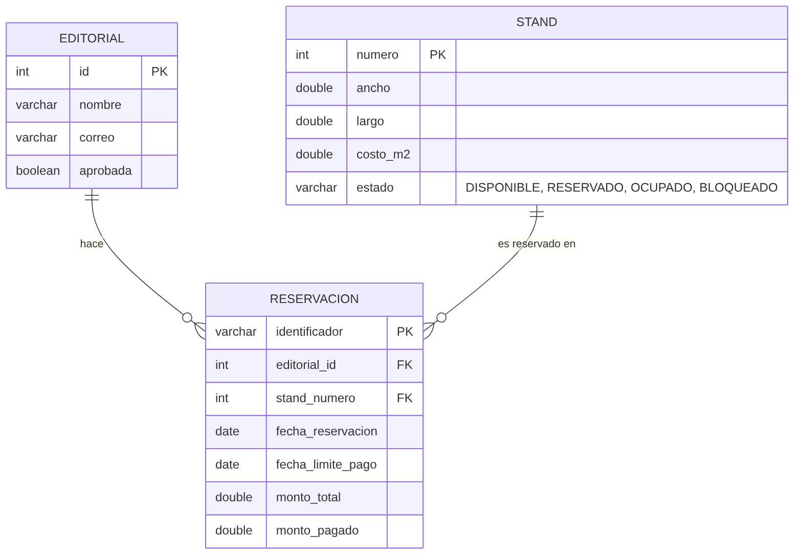

# FILEY – MVC + capa de base de datos (JDBC)

Aplicación Java que se conecta a una base de datos **H2 en memoria** con **JDBC** y lee las tablas **Stands**, **Editorial** y **Reservación**. Usa el patrón **MVC** más una **capa de BD** (DAO) separada.

## Video
https://youtu.be/Ji4j53eWk1E


## Contenido

| Entregable | Dónde está |
|------------|-----------|
| Código (MVC + BD) | [`src/filey`](src/filey) |
| Diagrama de clases | [`DOCUMENTACION.md`](DOCUMENTACION.md#4-diagrama-de-clases) y [`docs/diagramas/clases.png`](docs/diagramas/clases.png) |
| Diagrama de Entidad-Relación | [`DOCUMENTACION.md`](DOCUMENTACION.md#3-diagrama-de-entidad-relación) y [`docs/diagramas/er.png`](docs/diagramas/er.png) |
| Documentación completa | [`DOCUMENTACION.md`](DOCUMENTACION.md) |
| Guion del video | [`docs/GUION_VIDEO.md`](docs/GUION_VIDEO.md) |



## Arquitectura

```
Main ──► Controlador ──► Vista            (presentación en consola)
             │
             └──► DAO (interfaz) ──► DAO JDBC ──► ConexionBD ──► H2
                         │
                         └── crea objetos del Modelo (Stand, Editorial, Reservacion)
```

| Paquete | Capa |
|---------|------|
| `filey.modelo` | Modelo: entidades |
| `filey.bd` y `filey.bd.jdbc` | Capa de BD: conexión, DAO e implementaciones JDBC |
| `filey.controlador` | Controlador: pide datos a la BD y los entrega a la vista |
| `filey.vista` | Vista: presenta los datos en consola |

## Requisitos

- **JDK 17 o superior** (`java -version`).
- **Driver de H2** en `lib/` (ver [`lib/LEEME.txt`](lib/LEEME.txt)).

## Compilar y ejecutar

**Windows (PowerShell)**, desde la raíz del repositorio:

```powershell
javac -encoding UTF-8 -d out (Get-ChildItem -Recurse src -Filter *.java).FullName
java -cp "out;lib/*" filey.Main
```

**Linux / Mac:**

```bash
javac -encoding UTF-8 -d out $(find src -name "*.java")
java -cp "out:lib/*" filey.Main
```

## Qué hace `Main`

1. Muestra que la conexión a la base de datos funciona (URL, motor, versión y driver).
2. Crea las tablas y carga datos de ejemplo.
3. Presenta las listas de **Stands**, **Editoriales** y **Reservaciones**.
4. Hace una consulta por clave a cada tabla.

Si falta el driver, muestra `Falta el driver JDBC: agrega h2-*.jar al classpath` y termina con código 1.

## Autor

Eleazar Medina Uitz
